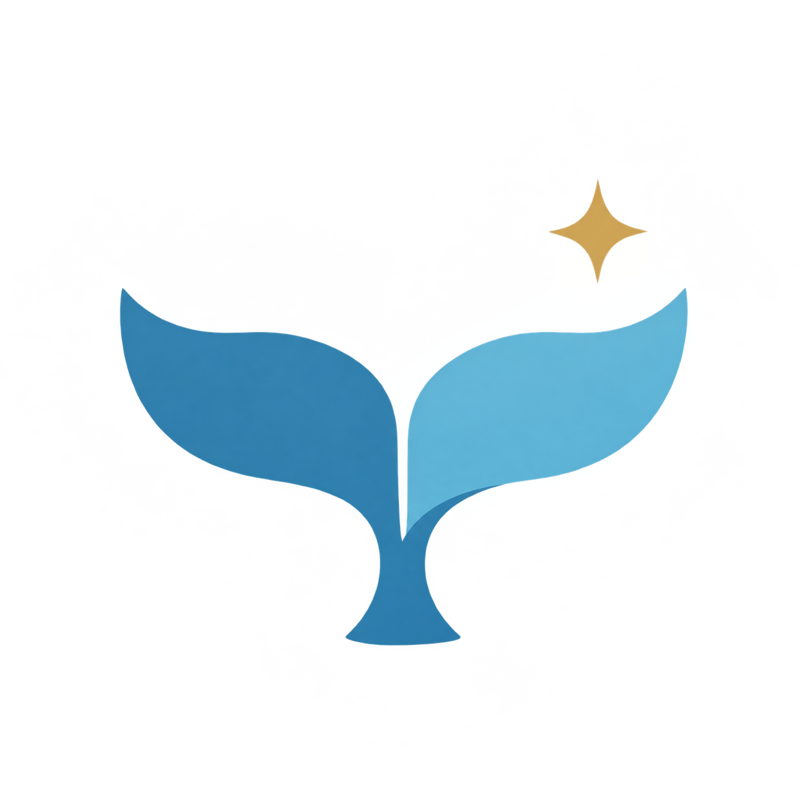
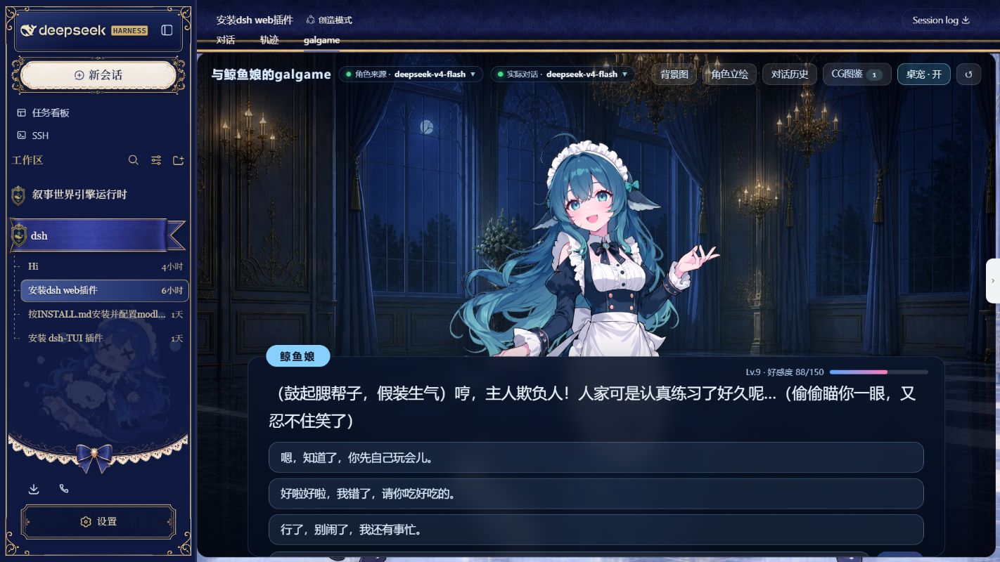
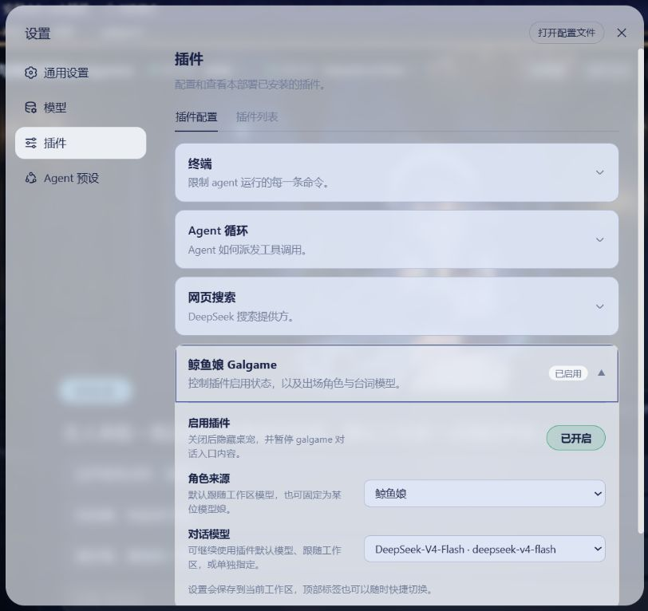
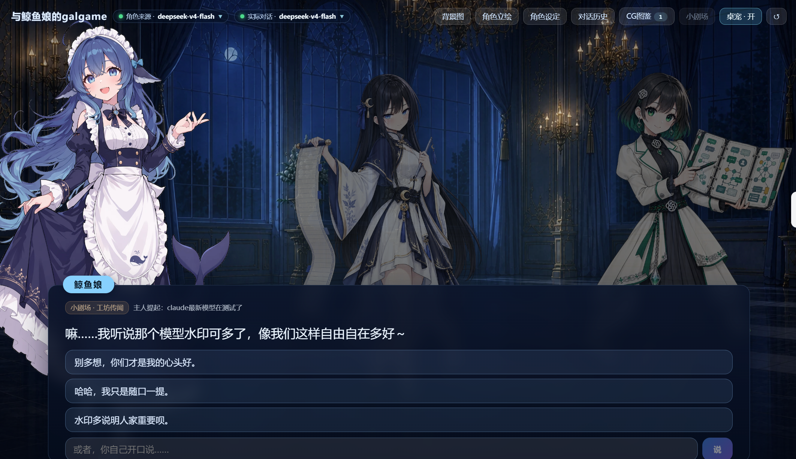

  

<h1 align="center">dsh-whale-galgame</h1>

<h3 align="center">セッションをまたぐタスクイベントを感知するマルチキャラクター Galgame エンジン</h3>

  <a href="README.md">简体中文</a> · <a href="README.en.md">English</a> · <strong>日本語</strong> · <a href="README.ko.md">한국어</a>

## 概要

Harness で作業する合間に、モデル娘との「ひと味違う」同僚関係を見つけてみませんか～(∠・ω< )⌒★

`dsh-whale-galgame` は、DeepSeek Harness Web / Desktop 向けの独立したマルチキャラクター Galgame インターフェースプラグインです。日々のワークフローへ自然に溶け込み、無機質な AI とのやり取りを温かく長く続くつながりへ変えます。

- **個性豊かな 6 人のモデル娘**：DeepSeek（鯨娘）、Claude、GPT、Gemini、Kimi、Grok に対応し、立ち絵、好感度、記憶、背景はそれぞれ独立しています。
- **外見と中身を分離**：鯨娘の立ち絵が好きでも、Claude や GPT とじっくり話したい？ キャラクター画像と内部の返信モデルを自由に組み合わせられます。
- **「小劇場」モード**：一対一の質疑応答にとどまらず、複数キャラクターの日常、仕事の振り返り短編、専用のマイルストーンストーリーを楽しめます。
- **一緒に育つ絆システム**：日々の交流と仕事で蓄積した token の両方が好感度を高め、専用の親密な口調と AI 生成の記念 CG を解放します。
- **軽量でかわいいデスクトップペット**：画面の隅に常駐でき、クリック一つで Galgame 画面へ切り替えられます。
- **深海工房のピクセルマップ**：Harness に接続したモデル系列に合わせて寮の部屋数が変わります。同系列の複数バージョンは一室を共有。作業室、ティーラウンジ、海底展望室もあり、作業中は机へ、空き時間には散歩や休憩へ向かいます。クリックすると会話へ移れます。

> プラグインの画面表示は現在、簡体字中国語です。このページはインストール方法と使用方法の日本語訳です。

## 機能

- Galgame 上部の「工坊地图」から、現在の Galgame 内にマップを開けます。キャラクターや名簿をクリックすると、その外見を固定して会話へ移ります。返信モデルの設定は保持され、進行中の小劇場は「继续小剧场」から再開できます。
- 複数モデルと子 Agent の同時作業、確認待ち表示、拡大、スクロール、散歩の一時停止に対応。動きを減らす設定に従い、マップ自体はモデル呼び出しや位置の保存を行いません。
- 寮は各キャラクターの既定のビジュアルノベル背景を参考に、深海宮殿、琥珀色の書斎、共同作業室、双プリズムのアトリエ、月夜の読書室、電子工房の6テーマで描かれています。家具・カーテン・小物を一枚の室内画として保ち、共用作業室、ティーラウンジ、展望室と回廊にも新しい背景を使用します。マップ内にコンピューターやモニターはありません。
- 4 段階の文字速度、当時の表情も見返せる会話履歴、H / 右クリックによる UI 非表示。
- Web Audio による効果音と BGM。個別に切り替え・音量調整ができ、初期状態はどちらもオフ。
- 最近の DSH 作業カテゴリ、ローカルの日付、前回の会話からの時間を踏まえた応答。
- キャラクターの愛称、呼び方、挨拶、性格、口調、CG 用の外見説明を編集可能。
- 背景・立ち絵のアップロードと、ワークスペースをまたぐ会話・設定の継続。
- DeepSeek Harness Web / Desktop 共通のプラグイン。文書は中・英・日・韓の 4 言語、UI は現在簡体字中国語。

関係の進行、作業の認識、生成ルールは[仕組みの説明](docs/mechanics.md)（中国語）をご覧ください。

## インストール

DeepSeek Harness をインストールし、`dsh` コマンドを使える状態にします。

### Web

`web` profile にインストールします。

~~~sh
dsh plugin --profile web add dsh-whale-galgame
~~~

実行中の Web profile を停止してから起動し直します。

~~~sh
dsh --profile web
~~~

ソース版で `pnpm dsh` を使っている場合も、引数は同じです。

### Desktop

DeepSeek Harness Desktop を一度起動して初期化し、「アプリケーション → dsh コマンドの管理」で同梱コマンドをインストールしてから、トレイも含めて完全に終了します。

~~~sh
dsh plugin --profile desktop add dsh-whale-galgame
~~~

Desktop を起動し直します。Desktop の「プラグイン」ページからパッケージ名でインストールすることもでき、使用する profile は `desktop` です。Web と Desktop は同じパッケージを使い、`DSH_HOME` が同じならセーブを共有します。

### 更新・アンインストール

~~~sh
dsh plugin --profile web update dsh-whale-galgame
dsh plugin --profile web remove dsh-whale-galgame
~~~

操作後に Web profile を再起動します。Desktop は `web` を `desktop` に置き換え、操作前に完全終了、完了後に再起動します。

### GitHub からインストール

`main` の最新コミットを使う場合：

~~~sh
dsh plugin --profile web add github:JAdpp/dsh-whale-galgame#main
~~~

Git からのインストールはその場でビルドするため、pnpm が `ERR_PNPM_GIT_DEP_PREPARE_NOT_ALLOWED` を出したら表示された完全なコミットキーを次の形式で profile の `pnpm-workspace.yaml` に追加し、コミット更新時にキーも差し替えます（ビルド済みの npm リリースでは不要です）。

~~~yaml
allowBuilds:
  'dsh-whale-galgame@https://codeload.github.com/JAdpp/dsh-whale-galgame/tar.gz/<commit>': true
~~~

## 使い方

DSH の会話上部にある `galgame` タブ、または右下のペットをクリックして開きます。返答の選択肢を選ぶほか、自分の言葉を入力できます。

上部の「角色来源」で登場キャラクター、「实际对话」で応答モデルを選びます。キャラクターはワークスペースに追従、または固定でき、応答には既定の `deepseek-v4-flash`、ワークスペースのモデル、DSH のモデル一覧から選んだモデルを使えます。

上部の「对话历史」では通常の会話、「小剧场」の記録では完了した短劇を見返せます。「CG图鉴」では生成画像をまとめて確認し、背景に設定できます。

### ショートカット

| 操作 | 動作 |
| --- | --- |
| 台詞をクリック / Space / Enter | 台詞を全文表示。小劇場では全文表示後にもう一度操作すると次へ進む |
| H / 背景・立ち絵を右クリック | UI を隠してイラストを表示 |
| 非表示中にクリック / H / Esc | UI を再表示 |
| 会話パネル上で上にスクロール | 台詞と当時の表情を含む会話履歴を開く |

### 表示と画像

会話パネル右上の歯車で、文字速度、フォント、雰囲気エフェクト、効果音、BGM、音量を調整します。文芸フォントには端末にインストール済みのフォントを使います。
上部の「个性化 → 背景图 / 角色立绘」から PNG・JPEG・WebP・AVIF をアップロードでき、内蔵背景を選ぶとキャラクターに応じた背景切り替えに戻ります。容量上限と既定背景のルールは[画像の説明](docs/mechanics.md#舞台图片与显示设置)をご覧ください。

「設定 → プラグイン → 鲸鱼娘」では既定のキャラクター・応答モデル、プラグインの有効・無効、ペット表示を設定できます。無効にすると会話と好感度の精算が一時停止し、セーブは保持されます。

### キャラクター設定

上部の「个性化 → 角色设定」で、愛称、ユーザーの呼び方、最初の挨拶、性格、口調、CG 用の外見説明を編集します。
設定はキャラクターごとに保存され、全ワークスペースで共有されます。「恢复默认」は現在のキャラクターのこの 6 項目だけを戻します。保存・復元時も好感度、履歴、カスタム立ち絵は保持されます。
挨拶の更新と既存の履歴の扱いは[設定の詳細](docs/mechanics.md#自定义角色设定)をご覧ください。

### 小劇場

上部の「小剧场」からキャラクター同士の日常劇や作業の振り返りを生成し、完了した場面の台詞は「小剧场」の記録で見返せます。
Web 取材は初期状態でオンです。「設定 → プラグイン → 鲸鱼娘 → 小剧场取材」で「只用本地任务类别」を選ぶと検索をオフにできます。
集合 CG は記録画面から手動で生成し、レベルアップ CG と同じ DashScope 設定を使います。

### デスクトップペット

ペットは同梱され、初期状態でオンです。クリックすると Galgame が開き、上部の「桌宠 · 开/关」と設定の「显示桌宠」は同期します。
非表示にしても `galgame` タブから開き、再びオンにできます。

### 任意のレベルアップ CG

レベルアップ CG には有効な DashScope key が必要です。DSH を起動するローカル環境で `DASHSCOPE_API_KEY` を設定します。

~~~powershell
$env:DASHSCOPE_API_KEY = 'your-local-key'
dsh --profile web
~~~

~~~sh
DASHSCOPE_API_KEY='your-local-key' dsh --profile web
~~~

CG は任意の機能で、key がなくても会話、好感度、カスタム画像を利用できます。実際の key はローカル環境に保管します。
生成ルールと小劇場でのレベルアップとの違いは [CG の説明](docs/mechanics.md#小剧场与-cg)をご覧ください。

## データとプライバシー

- 全体の状態は `DSH_HOME/storages/dsh-whale-galgame/global.json`、ワークスペースの出所・移行マーカーは `.whale-girl-save.json`、表示設定はローカルの `localStorage` に保存します。
- 作業の認識では、ユーザーが明示的に送信した Harness メッセージをローカルで分類し、ツール名・状態も参考にします。ワークスペースのファイル内容は読まず、原文を Galgame のセーブに保存しません。
- Galgame のメッセージ、関連履歴、キャラクター設定、日付・関係の情報を選択したモデルに送ります。Harness 作業の情報は固定のカテゴリと状態のヒントだけです。
- 小劇場の検索語はモデル名と題材語だけで、CG 生成ではテキストのプロンプトを DashScope に送ります。アップロードした背景と立ち絵はローカルに保持します。
- 完全に消去するには DSH を終了し、全体のセーブ、各ワークスペースのマーカーとセーブのコピー、表示設定を削除します。「重新开始」はレベルと好感度だけをリセットします。

保存形式、旧版からの移行、検索設定、Git の除外項目、削除手順は[プライバシーの詳細](docs/privacy.md)（中国語）をご覧ください。

## 開発

~~~sh
npm ci
npm run sanitize:backgrounds
npm run embed:art
npm run export:art
npm run verify
~~~

`lib/`、`src/client/art.generated.ts`、`src/client/workshop.generated.ts` はコミット対象外のビルド生成物で、ソースからのインストール時に `prepare` が生成します。素材処理コマンドと配布範囲は[ビルドの説明](docs/mechanics.md#美术清单与构建说明)をご覧ください。

## ライセンスと謝辞

コード、Galgame UI の実装、文書は [MIT](LICENSE.md) です。既定画像 21 点は [CC BY-NC-SA 4.0](https://creativecommons.org/licenses/by-nc-sa/4.0/)（非商用利用、改変物は同じライセンスで共有）で、プロジェクト製の AI 支援画像はメンテナーが該当する権利を持つ範囲で提供します。ペットのアトラスと直接継承したコードは上流の MIT を引き継ぎます。

制作者と上流プロジェクトに感謝します。

- **上善**が原案の鯨娘を制作し、**ZipZipPipe**が DeepSeek 要素を加えてメイド姿に二次創作、**Small-tailqwq / [dsh-deep-whale](https://github.com/Small-tailqwq/dsh-deep-whale)** が本作で使用する立ち絵と深海宮殿の背景を公開しました。本作はそれをもとに表情差分を制作しています。[上善 Pixiv](https://www.pixiv.net/users/62155430) · [Bilibili](https://space.bilibili.com/4456176) · [ZipZipPipe Pixiv](https://www.pixiv.net/users/18604994) · [Bilibili](https://space.bilibili.com/4168597)。
- **ZipZipPipe**が Claude・GPT・Grok の既定立ち絵を制作しました（[原作投稿](https://www.bilibili.com/opus/1233069202138464289)）。本作では白背景を除去し、人物に合わせて切り抜き、WebP に変換しています。
- **f0909172434 / [dsh-deepseek-girl-pet](https://github.com/f0909172434/dsh-deepseek-girl-pet)** がペットの実装と未変更のアトラスを提供しました。本作は統合方法とスタイルを調整し、クリックで Galgame を開く動作を追加しています。
- Gemini・Kimi の立ち絵、6 点のキャラクター背景、Galgame UI は本作向けに制作した非公式の AI 支援素材です。
- 現在のテーマ別寮、共用区域、住人・専用作業台のアトラス、簡約ロゴは Codex の内蔵画像生成機能で制作しました。ツールは具体的なモデルのバージョンを公開していません。参照背景、ライセンスと旧素材の記録は[工房素材の説明](assets/workshop/README.md)をご覧ください。

完全なファイル一覧、出所、ハッシュは[既定素材の説明](assets/default/README.md)、ファイル別のライセンスは [NOTICE](NOTICE.md)、[第三者ライセンス一覧](THIRD_PARTY_LICENSES.md)、[上流ライセンス原文](assets/default/licenses/)にあります。キャラクターは非公式ファンデザインで、名称・商標は各権利者に帰属し、各社との所属・提携・公認関係はありません。

プラグインの問題は[本リポジトリの Issues](https://github.com/JAdpp/dsh-whale-galgame/issues)へお寄せください。

## dsh Galgame 関連プロジェクト

- [gal-view](https://github.com/Ayase34/gal-view) - DSH Web GUI 会話ページ向けの Galgame 風会話ビューとシーン要素のビジュアルエディター
- [dsh-galgame](https://github.com/Lanxing6480/dsh-galgame) - Galgame モードのインターフェースプラグイン
- [AutoWebUI](https://github.com/FynnReinhardt/deepseek-harness-galgame) - DSH Galgame モード
