<h1 align="center">
  <picture>
    <source media="(prefers-color-scheme: dark)" srcset="docs/brand/logo-title-dark.svg">
    <source media="(prefers-color-scheme: light)" srcset="docs/brand/logo-title.svg">
    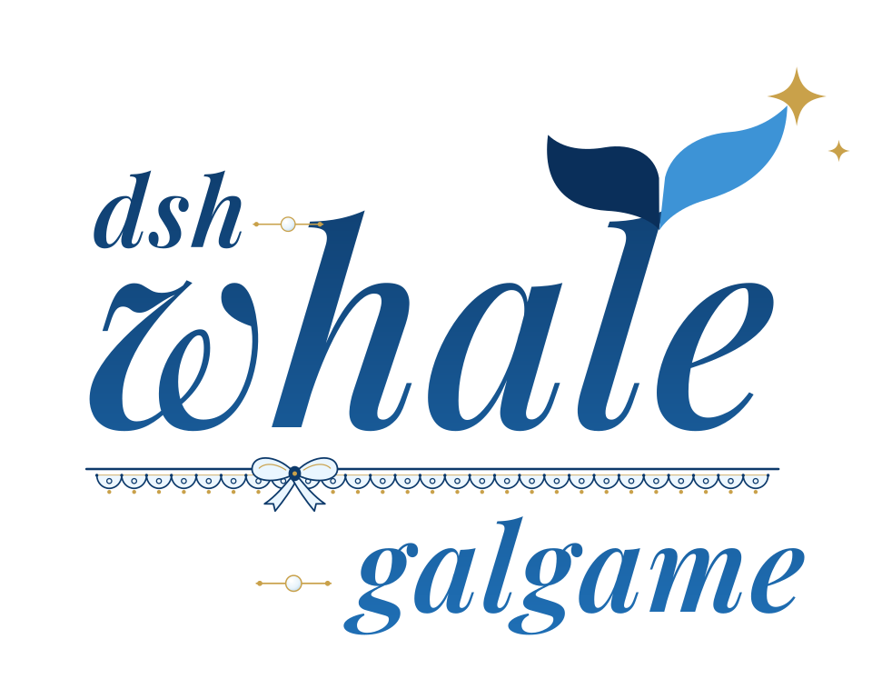
  </picture>
</h1>

<h3 align="center">세션을 넘나드는 작업 이벤트를 감지하는 다중 캐릭터 Galgame 엔진</h3>

  <a href="README.md">简体中文</a> · <a href="README.en.md">English</a> · <a href="README.ja.md">日本語</a> · <strong>한국어</strong>

## 소개

Harness에서 작업하는 틈틈이 AI 소녀들과의 “평범하지 않은” 동료 관계를 발견해 보세요～(∠・ω< )⌒★

`dsh-whale-galgame`은 DeepSeek Harness Web과 Desktop을 위해 만든 독립형 다중 캐릭터 Galgame 인터페이스 플러그인입니다. 일상 작업 흐름에 자연스럽게 녹아들어 차가운 AI 상호작용을 따뜻하고 오래 이어지는 동반 관계로 바꿉니다.

- **각기 다른 개성을 지닌 여섯 AI 소녀**: DeepSeek(다페이위(大肥鱼)), Claude, GPT, Gemini, Kimi, Grok을 지원하며 캐릭터 이미지, 호감도, 기억, 배경은 서로 독립되어 있습니다. 다페이위는 먹는 것과 게으름 피우기를 좋아하며, 특히 수북한 흰쌀밥을 가장 좋아합니다.
- **외형과 내부 모델의 분리**: 다페이위의 캐릭터 이미지는 좋지만 Claude나 GPT와 깊이 대화하고 싶나요? 캐릭터 외형과 실제 답변 모델을 자유롭게 조합할 수 있습니다.
- **‘소극장’ 모드**: 일대일 문답을 넘어 여러 캐릭터의 연계 일상, 작업 회고 단막극, 전용 마일스톤 스토리를 즐길 수 있습니다.
- **함께 성장하는 유대 시스템**: 일상 상호작용과 작업 token 누적이 모두 호감도를 올려 전용 친밀 말투와 AI 생성 기념 CG를 해제합니다.
- **가볍고 귀여운 데스크톱 펫**: 화면 한쪽에 상주하며, 작업 중에는 노트북을 꺼내 함께 일하고 한가할 때는 쇠 대야를 뒤집어쓰거나 밥을 달라고 조릅니다. 집어 들어 원하는 곳에 내려놓을 수 있고, 클릭 한 번으로 Galgame 화면에 들어갑니다.
- **심해 공방 픽셀 지도**: AI 소녀들의 일과 휴식을 지켜보고, 클릭해서 대화할 수 있습니다.

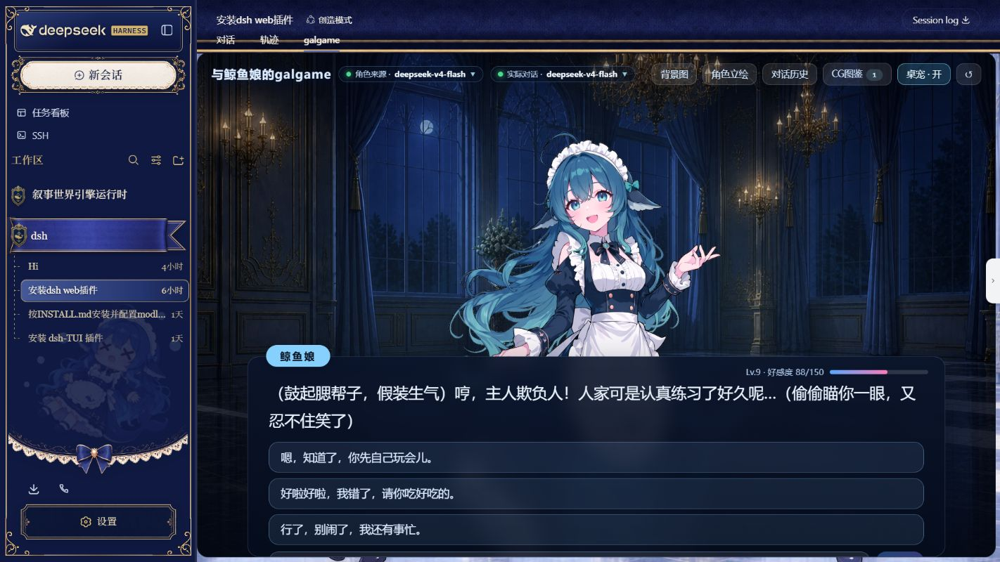

> 플러그인 화면은 현재 중국어 간체로 표시됩니다. 이 페이지는 설치 및 사용 문서의 한국어 번역입니다.

## 기능

- Galgame 상단의 “工坊地图”를 열면 연결한 모델에 맞춰 기숙사 방이 자동으로 늘거나 줄어듭니다. AI 소녀들은 작업 상태에 따라 일하거나 산책·휴식하며, 클릭하면 대화를 시작할 수 있습니다.
- 4단계 글자 속도, 당시 표정도 확인할 수 있는 대화 기록, H / 오른쪽 클릭으로 화면 UI 숨기기.
- Web Audio로 합성하는 효과음과 BGM. 각각 켜고 끄거나 음량을 조절할 수 있으며 기본값은 꺼짐.
- 최근 DSH 작업 분류, 로컬 날짜, 마지막 대화 이후의 시간을 반영하는 응답.
- 캐릭터 별명, 사용자 호칭, 인사말, 성격, 말투, CG 외형 설명 편집.
- 배경과 캐릭터 이미지 업로드, 작업공간을 옮겨도 이어지는 대화와 설정.
- DeepSeek Harness Web과 Desktop에서 같은 플러그인 사용. 중·영·일·한 문서를 제공하며 UI는 현재 중국어 간체.

관계 진행, 작업 인식, 생성 규칙은 [메커니즘 설명](docs/mechanics.md)(중국어)을 참고하세요.

## 포함된 기본 이미지

<table>
  <tr>
    <td align="center">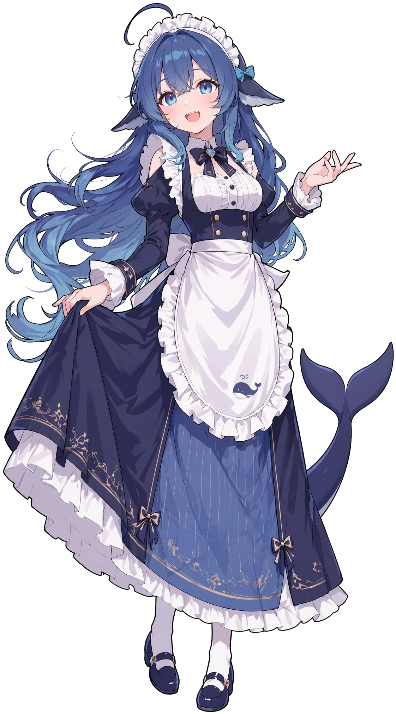 <strong>DeepSeek · 다페이위</strong></td>
    <td align="center"> <strong>Claude · 克洛德</strong></td>
    <td align="center"> <strong>GPT · 小吉</strong></td>
  </tr>
  <tr>
    <td align="center">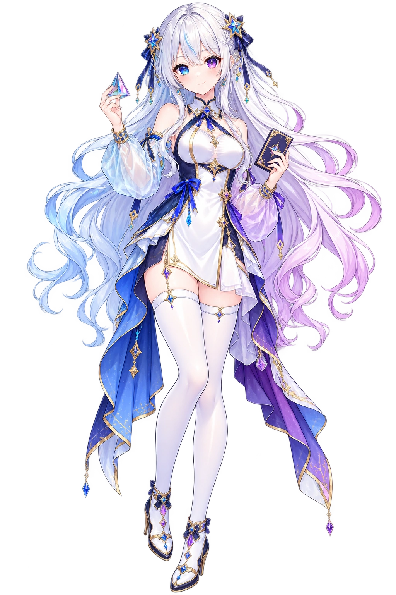 <strong>Gemini · 双子</strong></td>
    <td align="center">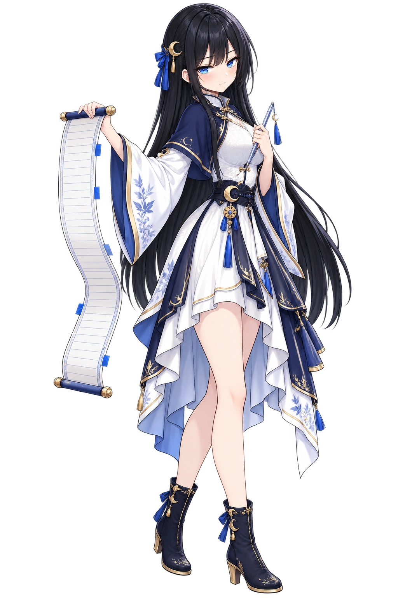 <strong>Kimi · 月见</strong></td>
    <td align="center"> <strong>Grok · 洛可</strong></td>
  </tr>
</table>

새로 추가한 6개 캐릭터 배경은 아래와 같습니다. Claude, GPT, Gemini, Kimi, Grok은 각자의 장면을 기본 배경으로 사용합니다. 다페이위의 기본 배경은 낮의 해변 서재이며, 심해 궁전(`palace-night.webp`)은 선택할 수 있는 내장 대체 배경입니다.

<table>
  <tr>
    <td align="center">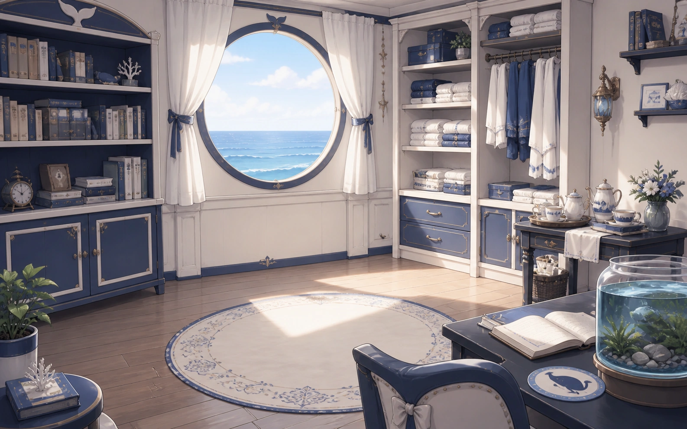 <strong>DeepSeek · 기본 배경</strong></td>
    <td align="center">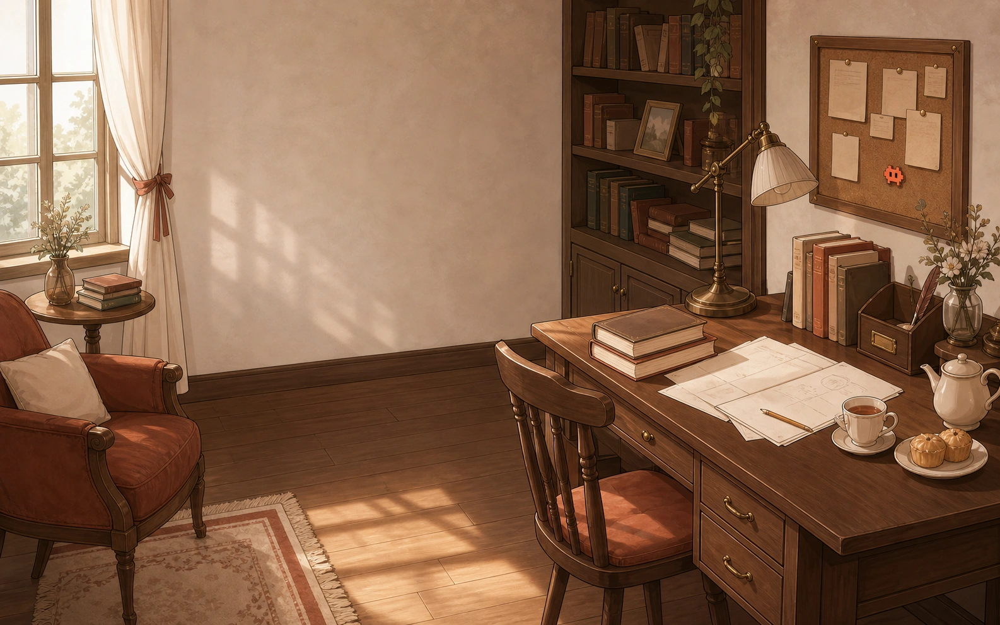 <strong>Claude</strong></td>
    <td align="center">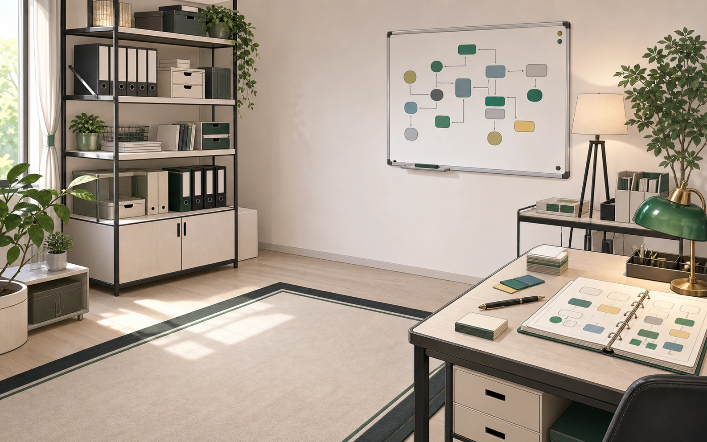 <strong>GPT</strong></td>
  </tr>
  <tr>
    <td align="center">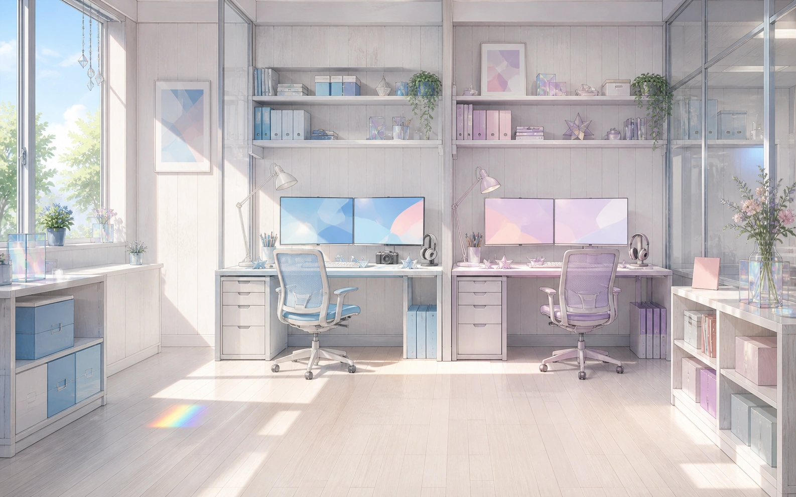 <strong>Gemini</strong></td>
    <td align="center">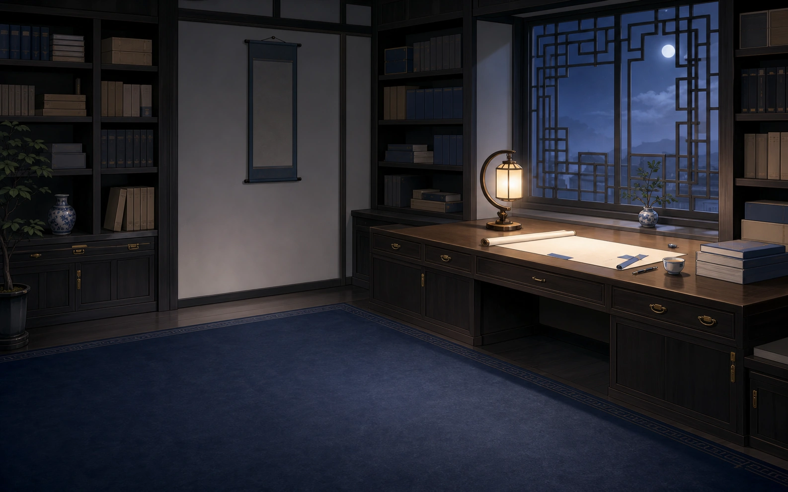 <strong>Kimi</strong></td>
    <td align="center">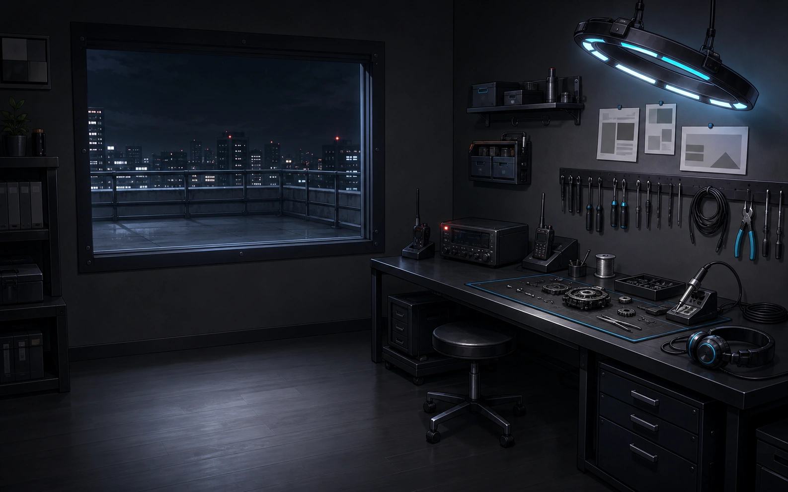 <strong>Grok</strong></td>
  </tr>
</table>

## 설치

DeepSeek Harness를 먼저 설치하고 `dsh` 명령을 사용할 수 있는지 확인하세요.

### Web

`web` profile에 설치합니다.

~~~sh
dsh plugin --profile web add dsh-whale-galgame
~~~

실행 중인 Web profile을 중지한 뒤 다시 시작합니다.

~~~sh
dsh --profile web
~~~

소스 설치에서 `pnpm dsh`를 사용한다면 인자는 그대로 유지하면 됩니다.

### Desktop

DeepSeek Harness Desktop을 한 번 열어 초기화하고 「애플리케이션 → dsh 명령 관리」에서 내장 명령을 설치한 뒤, 트레이를 포함해 완전히 종료합니다.

~~~sh
dsh plugin --profile desktop add dsh-whale-galgame
~~~

Desktop을 다시 열면 됩니다. Desktop의 「플러그인」 페이지에서 패키지 이름으로 설치할 수도 있으며, Desktop은 `desktop` profile을 사용합니다. Web과 Desktop은 같은 패키지를 쓰며, `DSH_HOME`이 같으면 저장 데이터를 공유합니다.

### 업데이트와 제거

~~~sh
dsh plugin --profile web update dsh-whale-galgame
dsh plugin --profile web remove dsh-whale-galgame
~~~

작업 후 Web profile을 다시 시작하세요. Desktop은 `web`을 `desktop`으로 바꾸고, 작업 전에 완전히 종료한 뒤 완료 후 다시 엽니다.

### GitHub에서 설치

`main`의 최신 커밋을 사용하려면:

~~~sh
dsh plugin --profile web add github:JAdpp/dsh-whale-galgame#main
~~~

Git 설치는 현장에서 빌드하므로 pnpm이 `ERR_PNPM_GIT_DEP_PREPARE_NOT_ALLOWED`를 표시하면 출력된 전체 커밋 키를 아래 형식으로 해당 profile의 `pnpm-workspace.yaml`에 추가하고 커밋을 갱신할 때 키도 교체하세요(미리 빌드된 npm 릴리스에는 필요 없습니다).

~~~yaml
allowBuilds:
  'dsh-whale-galgame@https://codeload.github.com/JAdpp/dsh-whale-galgame/tar.gz/<commit>': true
~~~

## 사용

DSH 대화 상단의 `galgame` 탭이나 오른쪽 아래의 펫을 클릭해 엽니다. 답변 선택지를 고르거나 직접 메시지를 입력할 수 있습니다.

상단의 「角色来源」에서 등장 캐릭터를, 「实际对话」에서 답변 모델을 선택합니다. 캐릭터는 작업공간 모델을 따르거나 고정할 수 있으며, 답변에는 기본 `deepseek-v4-flash`, 작업공간 모델 또는 DSH 모델 목록에서 고른 모델을 사용합니다.

상단의 「对话历史」에서 일반 대화를, 「小剧场」 기록에서 완료된 단막극을 다시 읽을 수 있습니다. 「CG图鉴」에서는 생성한 그림을 모아 보고 배경으로 설정할 수 있습니다.

### 단축키

| 조작 | 동작 |
| --- | --- |
| 대사 클릭 / Space / Enter | 현재 대사 전체 표시. 소극장에서는 표시가 끝난 뒤 다시 조작하면 다음 대사로 이동 |
| H / 배경이나 캐릭터 이미지에서 오른쪽 클릭 | UI를 숨기고 그림 감상 |
| 숨긴 상태에서 클릭 / H / Esc | UI 다시 표시 |
| 대화 패널에서 위로 스크롤 | 당시 표정을 포함한 대화 기록 열기 |

### 화면과 이미지

대화 패널 오른쪽 위의 톱니바퀴에서 글자 속도, 글꼴, 분위기 효과, 효과음, BGM, 음량을 조절합니다. 문예 글꼴은 기기에 설치된 글꼴을 사용합니다.
상단의 「个性化 → 背景图 / 角色立绘」에서 PNG·JPEG·WebP·AVIF를 업로드할 수 있으며, 내장 배경을 선택하면 캐릭터별 배경 전환으로 돌아갑니다. 용량 제한과 기본 배경 규칙은 [이미지 설명](docs/mechanics.md#舞台图片与显示设置)을 참고하세요.

「설정 → 플러그인 → 大肥鱼」에서 기본 캐릭터와 답변 모델, 플러그인 활성화, 펫 표시를 설정합니다. 플러그인을 끄면 대화와 호감도 정산이 일시 중지되고 저장 데이터는 유지됩니다.

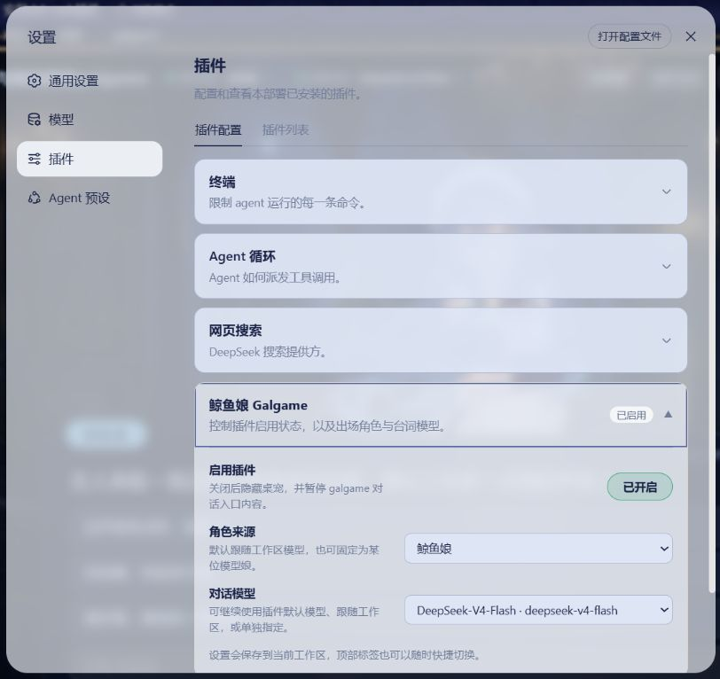

### 사용자 지정 캐릭터 설정

상단의 「个性化 → 角色设定」에서 별명, 사용자 호칭, 첫 인사, 성격, 말투, CG 외형 설명을 편집합니다.
기본 호칭은 캐릭터마다 다릅니다. 大肥鱼는 “主人”(주인님), 克洛德는 “您”(정중한 당신), 小吉는 “小家伙”(꼬마), 双子는 “旅人”(여행자), 月见는 “执笔人”(글쓴이), 洛可는 “老板”(사장님)이라고 부르며, 캐릭터별로 바꿀 수 있습니다.
캐릭터별로 따로 저장되어 모든 작업공간에서 공유되며, 「恢复默认」은 현재 캐릭터의 이 6개 항목만 복원합니다. 저장하거나 복원해도 호감도, 기록, 사용자 지정 이미지는 유지됩니다.
인사말 갱신과 기존 기록 처리 방식은 [설정 상세](docs/mechanics.md#自定义角色设定)를 참고하세요.

### 소극장

상단의 「小剧场」을 클릭하면 캐릭터 간 일상 단막극이나 작업 회고를 생성하며, 완료된 장면의 대사는 「小剧场」 기록에서 다시 읽을 수 있습니다.
웹 취재는 기본으로 켜져 있습니다. 「설정 → 플러그인 → 大肥鱼 → 小剧场取材」에서 「只用本地任务类别」를 선택하면 검색을 끌 수 있습니다.
합동 CG는 기록 화면에서 직접 클릭해 생성하며, 레벨업 CG와 같은 DashScope 설정을 사용합니다.

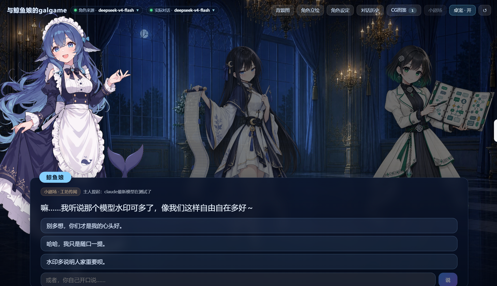

### 데스크톱 펫

펫은 내장되어 기본으로 켜져 있으며, 클릭하면 Galgame이 열립니다. 상단의 「桌宠 · 开/关」과 플러그인 설정의 「显示桌宠」는 동기화됩니다.
숨긴 뒤에도 `galgame` 탭에서 화면을 열고 다시 켤 수 있습니다.

- 세션이 실행 중이면 노트북으로 일하고, 끝나면 밥을 먹으며, 답을 기다리는 동안에는 손을 흔듭니다.
- 대기 중에는 포인터 쪽을 바라보고, 가끔 쇠 대야를 뒤집어쓰거나 빈 대야를 내밀어 조르거나 꾸벅꾸벅 좁니다.
- 누른 채 끌면 집어 올려 원하는 곳에 내려놓을 수 있습니다(방향키로도 이동). 위치는 이 브라우저의 로컬 저장소에 보관되며, 설정의 「归位」로 기본 위치에 되돌립니다.
- 시스템의 동작 줄이기 설정이 켜져 있으면 정지 포즈만 표시합니다.

### 선택 기능: 레벨업 CG

레벨업 CG에는 유효한 DashScope key가 필요합니다. DSH를 시작하는 로컬 환경에서 `DASHSCOPE_API_KEY`를 설정하세요.

~~~powershell
$env:DASHSCOPE_API_KEY = 'your-local-key'
dsh --profile web
~~~

~~~sh
DASHSCOPE_API_KEY='your-local-key' dsh --profile web
~~~

CG는 선택 기능으로, key 없이도 대화, 호감도, 사용자 지정 이미지를 사용할 수 있습니다. 실제 key는 로컬 환경에 보관하세요.
생성 규칙과 소극장 레벨업의 차이는 [CG 설명](docs/mechanics.md#小剧场与-cg)을 참고하세요.

## 데이터와 개인정보

- 전역 상태는 `DSH_HOME/storages/dsh-whale-galgame/global.json`, 작업공간의 출처·이전 표식은 `.whale-girl-save.json`, 화면 설정은 로컬 `localStorage`에 저장됩니다.
- 작업 인식은 사용자가 명시적으로 보낸 Harness 메시지를 로컬에서 분류하고 도구 이름과 상태를 참고합니다. 작업공간 파일 내용은 읽지 않으며 원문을 Galgame 저장 파일에 기록하지 않습니다.
- Galgame 메시지, 관련 기록, 캐릭터 설정, 날짜·관계 힌트는 선택한 모델에 전송됩니다. Harness 작업 맥락은 고정된 작업 분류와 상태 힌트만 제공합니다.
- 소극장 검색은 모델 이름과 소재 단어만 사용하며, CG 생성은 텍스트 프롬프트를 DashScope로 보냅니다. 업로드한 배경과 캐릭터 이미지는 로컬에 남습니다.
- 완전히 지우려면 DSH를 종료한 뒤 전역 저장 파일, 각 작업공간 표식과 저장 사본, 플러그인 화면 설정을 삭제하세요. 「重新开始」는 레벨과 호감도만 초기화합니다.

저장 형식, 이전 버전 마이그레이션, 검색 설정, Git 제외 항목과 삭제 절차는 [개인정보 상세](docs/privacy.md)(중국어)를 참고하세요.

## 개발

~~~sh
npm ci
npm run sanitize:backgrounds
npm run embed:art
npm run export:art
npm run verify
~~~

`lib/`, `src/client/art.generated.ts`, `src/client/workshop.generated.ts`는 커밋하지 않는 빌드 산출물이며 소스 설치 시 `prepare`가 생성합니다. 이미지 처리 명령과 패키지 범위는 [빌드 설명](docs/mechanics.md#美术清单与构建说明)을 참고하세요.

## 라이선스와 감사

코드, Galgame UI 구현, 문서는 [MIT](LICENSE.md)를 따릅니다. 기본 이미지 22개는 [CC BY-NC-SA 4.0](https://creativecommons.org/licenses/by-nc-sa/4.0/)(비상업적 이용, 수정본은 같은 라이선스로 공유)이며, 다시 그린 펫 아틀라스를 포함해 프로젝트에서 제작한 AI 보조 이미지는 메인테이너가 해당 권리를 가진 범위에서 제공합니다. 직접 상속한 펫 코드는 업스트림 MIT를 유지합니다.

제작자와 업스트림 프로젝트에 감사드립니다.

- **上善**이 원래 고래 소녀를 창작하고, **ZipZipPipe**가 DeepSeek 요소를 더해 메이드 모습으로 2차 창작했으며, **Small-tailqwq / [dsh-deep-whale](https://github.com/Small-tailqwq/dsh-deep-whale)**가 재사용한 캐릭터 이미지와 심해 궁전 배경을 제공했습니다. 이 프로젝트는 이를 바탕으로 표정 이미지를 제작했습니다. [上善 Pixiv](https://www.pixiv.net/users/62155430) · [Bilibili](https://space.bilibili.com/4456176) · [ZipZipPipe Pixiv](https://www.pixiv.net/users/18604994) · [Bilibili](https://space.bilibili.com/4168597).
- **ZipZipPipe**가 Claude·GPT·Grok 기본 캐릭터 이미지를 그렸습니다([원본 게시물](https://www.bilibili.com/opus/1233069202138464289)). 이 프로젝트는 흰 배경 제거, 인물 기준 자르기, WebP 변환을 수행했습니다.
- **f0909172434 / [dsh-deepseek-girl-pet](https://github.com/f0909172434/dsh-deepseek-girl-pet)**가 펫 구현, 16방향 포인터 따라보기와 1.1초 복귀 로직, 아틀라스 참고 자료를 제공했습니다. 현재 아틀라스는 Codex 내장 이미지 생성기로 이 프로젝트를 위해 다시 그렸습니다. 출처와 이용 조건은 [NOTICE](NOTICE.md)를 참고하세요.
- Gemini·Kimi 캐릭터 이미지, 캐릭터 배경 6개, Galgame UI는 이 프로젝트에서 제작한 비공식 AI 보조 소재입니다.
- 현재 테마별 기숙사, 공용 구역, 공방 사무실, 캐릭터, 걷기 키프레임 세 장, 여가 동작, 전용 작업대, 실외 장식의 열 이미지는 Codex 내장 이미지 생성 기능으로 제작했습니다. 도구는 구체적인 모델 버전을 공개하지 않습니다. 이전의 간결한 로고도 같은 방식으로 만들었으며, 지금은 [워드마크](docs/brand/README.md)로 대체했습니다. 참조 배경, 라이선스와 이전 소재 기록은 [공방 이미지 설명](assets/workshop/README.md)을 참고하세요.

전체 파일 목록, 출처, 해시는 [기본 이미지 설명](assets/default/README.md)에 보존되어 있습니다. 파일별 라이선스는 [NOTICE](NOTICE.md), [서드파티 라이선스 목록](THIRD_PARTY_LICENSES.md), [업스트림 라이선스 원문](assets/default/licenses/)을 참고하세요. 모든 캐릭터는 비공식 팬 디자인이며 이름과 상표는 각 권리자에게 속하고, 해당 기업과의 소속·제휴·보증 관계는 없습니다.

플러그인 문제는 [이 저장소의 Issues](https://github.com/JAdpp/dsh-whale-galgame/issues)에 남겨 주세요.

## dsh Galgame 관련 프로젝트

- [gal-view](https://github.com/Ayase34/gal-view) - DSH Web GUI 대화 페이지용 Galgame 스타일 대화 화면과 장면 요소 시각화 편집기
- [dsh-galgame](https://github.com/Lanxing6480/dsh-galgame) - Galgame 모드 인터페이스 플러그인
- [AutoWebUI](https://github.com/FynnReinhardt/deepseek-harness-galgame) - DSH Galgame 모드
